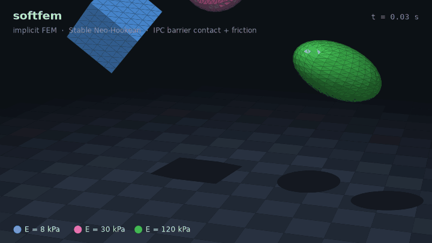
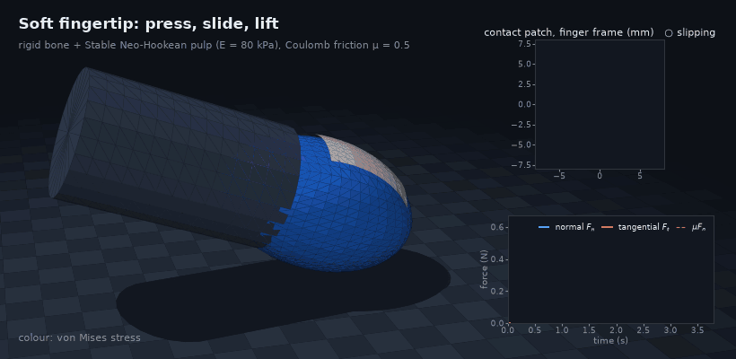
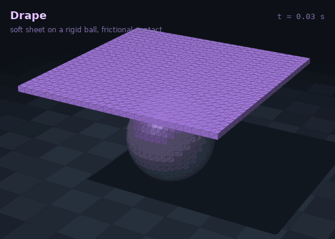
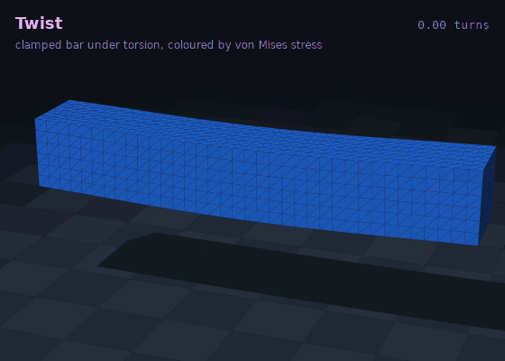
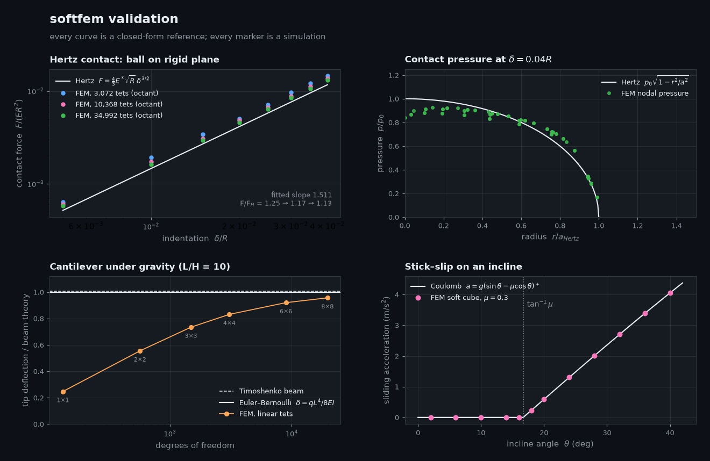

<h1 align="center">softfem</h1>

<p align="center">
  <b>Implicit finite-element simulation of soft bodies with frictional contact, written from scratch in NumPy + SciPy.</b>
</p>

<p align="center">
  <a href="https://github.com/Dy07077/softfem/actions/workflows/ci.yml"></a>
  
  
  
</p>

<p align="center">
  
  
</p>
<p align="center">
  
  
</p>

softfem is a compact, readable simulator for hyperelastic solids. Every time step is an energy
minimisation: elasticity, inertia, contact and friction are all potentials, and a projected Newton
solver finds their minimum. The core is about 1,100 lines with no compiled code. Every gradient and
Hessian is tested against finite differences, and the solver is checked against four closed-form
solutions.

## Highlights

- **Hyperelasticity.** Stable Neo-Hookean (Smith et al. 2018) on linear tetrahedra, with analytic
  gradients and Hessians, per-element PSD projection and per-element material parameters.
- **Implicit dynamics.** Backward Euler written as incremental-potential minimisation, solved with
  projected Newton, sparse direct solves and an Armijo line search.
- **Node contact without penetration.** An IPC log-barrier keeps every surface node off rigid planes
  and spheres. Every Newton step is capped by continuous collision detection, and prescribed motions
  pass the same check, so no node ever crosses an obstacle. Contact is node-based; see Limitations.
- **Coulomb friction.** IPC's lagged, smoothed friction captures stick, incipient slip and sliding.
- **Kinematic control.** Any subset of coordinates can follow a function of time: bones, clamps,
  symmetry planes.
- **Figures included.** A small matplotlib renderer with shading, shadows and GIF export made every
  animation on this page.

## Validation

<p align="center"></p>

| Benchmark | Reference | softfem |
| --- | --- | --- |
| Ball pressed on a plane | Hertz: $F=\tfrac43 E^\ast\sqrt{R}\,\delta^{3/2}$ | force–indentation slope **1.511** (theory 1.5); contact radius within 1%; force 25% → 17% → 12.6% above Hertz from 3k to 35k tets, so the force is the least accurate of the three |
| Cantilever under gravity | Euler–Bernoulli $\delta = qL^4/8EI$ | 25% → **96%** of the beam deflection from 132 to 20k DOF, the classic locking of linear tets |
| Block on an incline | Coulomb: sticks iff $\tan\theta\le\mu$, else $a=g(\sin\theta-\mu\cos\theta)$ | stick/slip threshold at $\tan^{-1}\mu$; acceleration error **< 2·10⁻⁵ m/s²** |
| Free fall | discrete backward Euler | exact to 10⁻¹⁰ |
| Isolated deforming body | conservation of linear momentum | conserved to 10⁻⁸ |

Run `python examples/validation.py` to regenerate the figure and the numbers in `assets/validation.json`.

## Quick start

```bash
git clone https://github.com/Dy07077/softfem && cd softfem
pip install -e ".[dev]"
pytest -q                       # 45 tests, a few seconds
python examples/fingertip.py    # writes assets/fingertip.gif
```

```python
import softfem as sf

cube = sf.box((0.2, 0.2, 0.2), res=(5, 5, 5), origin=(-0.1, -0.1, 0.05))
sim = sf.Simulator(cube, sf.StableNeoHookean(E=3e4, nu=0.4), dt=1 / 100,
                   obstacles=[sf.Plane(mu=0.5)])          # frictional floor at z = 0
for _ in range(150):
    sim.step()
print(sim.contact_forces()[0])            # ≈ (0, 0, weight)
print(sim.history[-1].iterations)         # Newton iterations of the last step
```

## How it works

Each step solves an unconstrained minimisation over all node positions $x$:

$$
x_{n+1}=\arg\min_x\;\frac{1}{2h^2}\lVert x-\tilde x\rVert_M^2+\Psi(x)+B(x)+D(x),
\qquad \tilde x=x_n+h\,v_n+h^2 g .
$$

- **Elasticity.** $\Psi=\sum_e V_e\,\psi(F_e)$ with the deformation gradient $F_e=D_s D_m^{-1}$
  of each tetrahedron and
  $\psi(F)=\tfrac{\mu}{2}(\operatorname{tr}F^\top F-3)-\mu(J-1)+\tfrac{\lambda'}{2}(J-1)^2$.
  There is no $\log J$, so inverted elements are handled gracefully. With $\lambda'=\lambda+\mu$
  the model linearises exactly to linear elasticity, which a unit test checks.
- **Contact.** $B=\kappa\sum_i A_i\,b(d_i)$ with the IPC barrier
  $b(d)=-(d-\hat d)^2\ln(d/\hat d)$ for $0<d<\hat d$. It is C², convex and unbounded as $d\to0$.
- **Friction.** $D=\sum_i \mu\,\lambda_i\,f_0\!\left(\lVert T_i^\top(x_i-x_i^n)\rVert\right)$, where
  the normal forces $\lambda_i$ and tangent frames $T_i$ are lagged from the start of the step and
  $f_0$ smooths $\lvert u\rvert$ below $\epsilon_v h$.
- **Solver.** Newton steps solve $Hp=-\nabla E$ with every element Hessian projected to be positive
  semi-definite. The step length starts at the CCD bound and halves until the Armijo condition holds.
  Prescribed coordinates are eliminated from the sparse system.

## Examples

| Script | What it shows | Runtime |
| --- | --- | --- |
| [`examples/jelly_drop.py`](examples/jelly_drop.py) | three bodies with E = 8, 30 and 120 kPa bounce and settle | ~5 min |
| [`examples/fingertip.py`](examples/fingertip.py) | soft fingertip on a rigid bone: press, drag 16 mm, lift; contact patch, slip front, F<sub>t</sub> → μF<sub>n</sub> | ~4 min |
| [`examples/drape.py`](examples/drape.py) | soft sheet draping over a rigid ball | ~1 min |
| [`examples/twist.py`](examples/twist.py) | clamped bar twisted by 1.25 turns | ~1.5 min |
| [`examples/validation.py`](examples/validation.py) | the validation figure above | ~3 min |

Every script accepts `--quick` for a low-resolution run that takes seconds. Runtimes are full runs
on an Apple-silicon laptop, with NumPy 2.5 and SciPy 1.18 installed by pip.

## Project layout

```text
softfem/
├── mesh.py         tet meshes: boxes, balls (spherified cube), graded grids, surface extraction
├── materials.py    linear elasticity, Stable Neo-Hookean, PSD projection, von Mises stress
├── fem.py          deformation gradients, element forces/Hessians, sparse assembly
├── contact.py      IPC barrier, CCD for planes and spheres, lagged smoothed friction
├── solver.py       backward Euler / quasi-static Newton solver and kinematic constraints
├── validation.py   Hertz, cantilever and incline benchmarks (used by tests and figures)
└── render.py       matplotlib renderer and GIF writer
```

## Limitations

- Contact is between mesh nodes and analytic obstacles. Against a plane that keeps whole faces out
  too, because a half-space is convex, but edges and faces are not tested against spheres, so a ball
  small compared with the mesh spacing can pass between nodes. Self-contact and body–body contact
  need IPC's point–triangle and edge–edge distances plus CCD, which is the next step.
- Linear tetrahedra are stiff in bending and near incompressibility, as the cantilever plot shows.
  Quadratic or mixed elements would converge faster.
- The linear solver is SciPy's SuperLU, which is comfortable up to about 50k degrees of freedom.

## References

1. B. Smith, F. de Goes, T. Kim. *Stable Neo-Hookean Flesh Simulation.* ACM TOG 37(2), 2018.
2. T. Kim, D. Eberle. *Dynamic Deformables: Implementation and Production Practicalities.* SIGGRAPH Courses, 2020.
3. M. Li et al. *Incremental Potential Contact: Intersection- and Inversion-free, Large-Deformation Dynamics.* ACM TOG 39(4), 2020.
4. E. Sifakis, J. Barbič. *FEM Simulation of 3D Deformable Solids.* SIGGRAPH Courses, 2012.
5. K. L. Johnson. *Contact Mechanics.* Cambridge University Press, 1985.

## License

MIT © 2026 Ding Yuan
